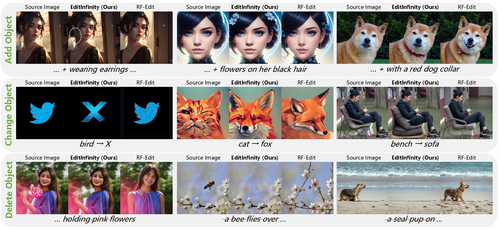
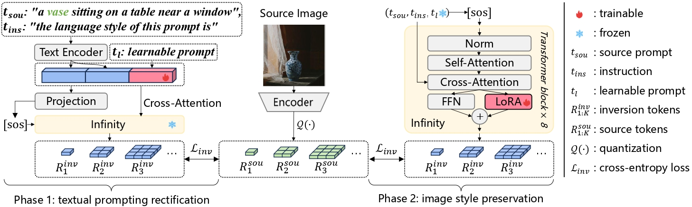
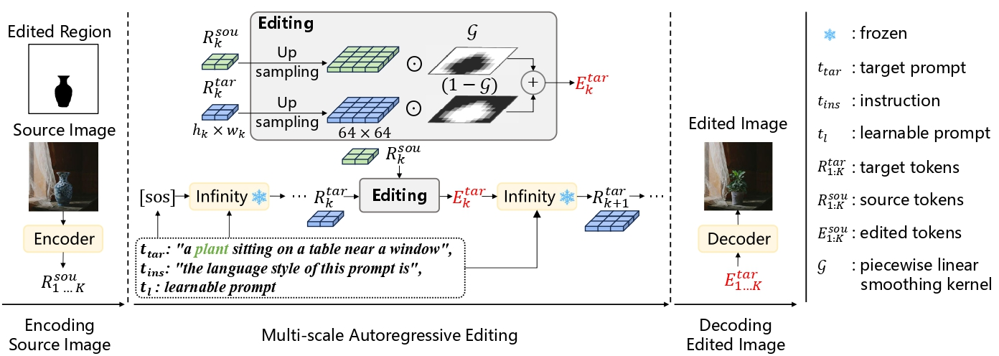
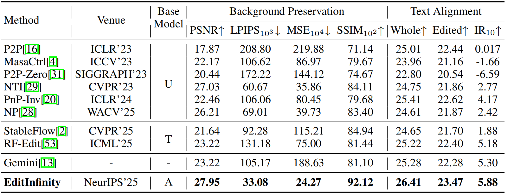
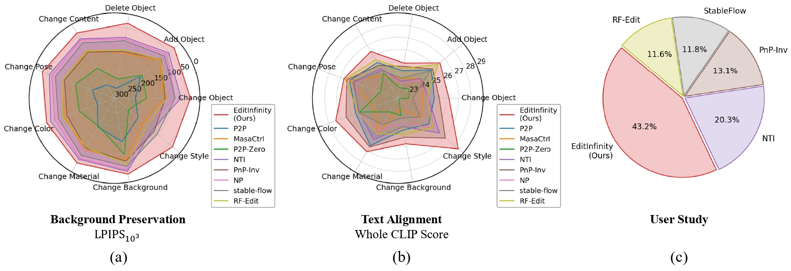
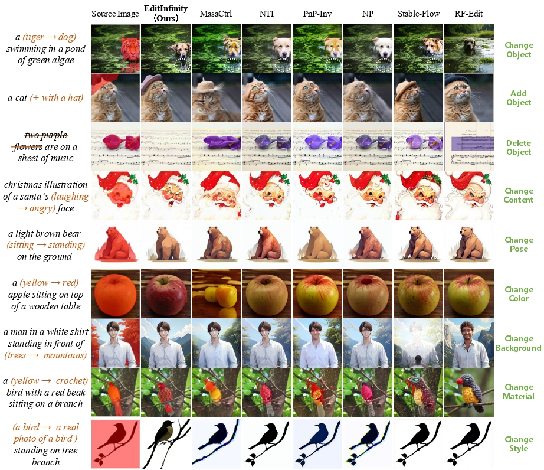
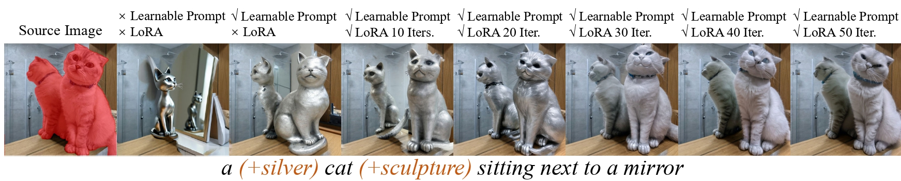

<div align="center">

# EditInfinity: Image Editing with Binary-Quantized Generative Models

**Official implementation · NeurIPS 2025**

[](https://arxiv.org/abs/2510.20217)
[](LICENSE)

**[Introduction](#introduction) · [Method](#method) · [Results](#results) · [Setup](#environment-setup) · [Quick Start](#quick-start) · [Citation](#citation)**

</div>

<p align="center">
  
  <br>
  <em>EditInfinity excels in <strong>background preservation</strong> and <strong>text alignment</strong>.</em>
</p>

💬 Questions about the paper or reproducing the results? Please [open an issue](https://github.com/yx-chen-ust/EditInfinity/issues).

## 📰 News

- **Nov 25, 2025:** Poster session announced for **December 4, 11:00–14:00**, at **Exhibit Hall C, D, E #4518**, San Diego.
- **Oct 24, 2025:** 📄 Paper released.
- **Sep 22, 2025:** 💻 Code released.
- **Sep 18, 2025:** 🎉 EditInfinity accepted to **NeurIPS 2025**!

<a id="introduction"></a>

## 📖 Introduction

- **Parameter-efficient image editing.** EditInfinity follows the inversion-editing paradigm on top of **Infinity**, a binary-quantized generative model.
- **Faithful reconstruction and editing.** Text prompt rectification and style preservation use exact quantized representations as supervision. **Holistic smoothing** further preserves source-image structure while aligning edits with the target prompt.
- **Strong results on PIE-Bench.** EditInfinity outperforms state-of-the-art diffusion-based models across editing tasks, with particular strengths in **background preservation** and **semantic consistency**.

<a id="method"></a>

## 🧩 Method

### Image Inversion with Exact Supervision

<p align="center">
  
</p>

Given a source image $I_{sou}$ and its prompt $t_{sou}$:

1. **Quantize the image** into exact tokens $R_{1...K}^{sou}$.
2. **Optimize the learnable prompt.** Concatenate $t_{sou}$, an instruction $t_{ins}$, and a learnable prompt $t_l$. Optimize $t_l$ with $\mathcal{L}_{inv}$ under the supervision of $R_{1...K}^{sou}$.
3. **Refine the reconstruction.** Freeze the prompt and apply **LoRA** to Infinity's FFN layers to further reconstruct $I_{sou}$.

### Image Editing with Holistic Smoothing

<p align="center">
  
</p>

Given a source image and a target editing prompt:

1. **Encode the source image** into tokens $R_{1...K}^{sou}$.
2. **Generate and blend tokens.** At each autoregressive step $k$, generate $R_k^{tar}$ conditioned on the target prompt $t_{tar}$, instruction $t_{ins}$, and optimized prompt $t_l$. Blend it with $R_k^{sou}$ using the piecewise linear smoothing kernel $\mathcal{G}$ to form $E_k^{tar}$, which guides the next-scale generation.
3. **Decode the edited image** from $E_{1...K}^{tar}$.

<a id="results"></a>

## 📊 Results

### Quantitative Results on PIE-Bench

<p align="center">
  
  
  <br>
  <em>Quantitative results on PIE-Bench.</em>
</p>

### Qualitative Results on PIE-Bench

<p align="center">
  
  <br>
  <em>Qualitative results across all nine editing tasks.</em>
</p>

<a id="environment-setup"></a>

## 🔧 Environment Setup

**Requirements:** PyTorch **≥ 2.5.1**, CUDA, and a compatible **FlashAttention** build. The example below uses **Python 3.10 · PyTorch 2.5.1 · CUDA 11.8**.

```bash
git clone https://github.com/yx-chen-ust/EditInfinity.git
cd EditInfinity

conda create -n EditInfinity python=3.10 -y
conda activate EditInfinity

pip install torch==2.5.1+cu118 torchvision==0.20.1+cu118 torchaudio==2.5.1+cu118 \
  --index-url https://download.pytorch.org/whl/cu118
pip install -r requirements.txt
```

Download a wheel from [FlashAttention Releases](https://github.com/Dao-AILab/flash-attention/releases/) that matches your **CUDA, PyTorch, Python, platform, and C++ ABI**. For the environment above on Linux x86_64, the [v2.7.3](https://github.com/Dao-AILab/flash-attention/releases/tag/v2.7.3) example is:

```bash
# Run after downloading the wheel to the current directory.
pip install flash_attn-2.7.3+cu11torch2.5cxx11abiFALSE-cp310-cp310-linux_x86_64.whl
```

<a id="pretrained-weights"></a>

## 📦 Pretrained Weights

Download the following weights from **Hugging Face**. Run these and all subsequent commands from the **repository root**.

| Component | Model | Local path |
|:--|:--|:--|
| Text encoder | [FLAN-T5-XL](https://huggingface.co/google/flan-t5-xl) | `weights/flan-t5-xl/` |
| Generative model | [Infinity 2B](https://huggingface.co/FoundationVision/Infinity/tree/main) | `weights/infinity_2b_reg.pth` |
| Image tokenizer | [Infinity VAE](https://huggingface.co/FoundationVision/Infinity/tree/main) | `weights/infinity_vae_d32reg.pth` |

```bash
mkdir -p weights
huggingface-cli download google/flan-t5-xl --local-dir ./weights/flan-t5-xl --local-dir-use-symlinks False
huggingface-cli download FoundationVision/Infinity --include infinity_2b_reg.pth --local-dir ./weights --local-dir-use-symlinks False
huggingface-cli download FoundationVision/Infinity --include infinity_vae_d32reg.pth --local-dir ./weights --local-dir-use-symlinks False
```

<a id="quick-start"></a>

## 🚀 Quick Start

Complete [Environment Setup](#environment-setup) and download the [pretrained weights](#pretrained-weights), then try one of the **three prepared examples** below.

### 1. Choose an editing example

| Example | Editing mode | Mask input |
|:--|:--|:--|
| [**Case 1**](example_case/example_1) | Full-image editing without background preservation | None |
| [**Case 2**](example_case/example_2) | Editing with background preservation | User-provided `image/mask.png` |
| [**Case 3**](example_case/example_3) | Editing with background preservation | Automatically generated from `prompt/target_word.txt` |

**Case 3:** Set the target word in [`target_word.txt`](example_case/example_3/prompt/target_word.txt). Adjust `--threshold` in [`get_weighted_tensor.sh`](example_case/example_3/scripts/get_weighted_tensor.sh) if needed; the default is **0.5**.

### 2. Configure paths and hardware

From the **repository root**, make the project importable for all pipeline stages:

```bash
export PYTHONPATH="$PWD${PYTHONPATH:+:$PYTHONPATH}"
```

Check the training launcher for your chosen case: `example_case/example_N/scripts/train_EditInfinity_exampleN.sh` (replace `N` with **1**, **2**, or **3**).

- **GPUs:** The launchers default to `CUDA_VISIBLE_DEVICES=0,1` and `--nproc_per_node=2`. Adjust both to match your available GPUs. Preparation, inference, and attention-map scripts use GPU `0` by default; update their `CUDA_VISIBLE_DEVICES` settings if needed.
- **Network:** Set `NCCL_SOCKET_IFNAME` to an available interface on your machine; the scripts use `eno1` by default. If the rendezvous port is already in use, change `--master_port` as well.

### 3. Run the pipeline

Choose a case and launch its complete editing pipeline:

```bash
EDIT_CASE=1  # Choose 1, 2, or 3.
bash "example_case/example_${EDIT_CASE}/scripts/edit_pipeline.sh"
```

Each pipeline runs **data preparation → learnable prompt training → LoRA training → inference**. Case 3 also generates a target-word attention map and background mask before final inference.

**Results** are saved under `example_case/example_N/output/` for the selected case.

### 4. Customize inputs and parameters

- **Inputs:** To edit your own image, replace `image/original_image.jpg`, `prompt/original_image_prompt.txt`, and `prompt/edit_image_prompt.txt` in the selected example folder. For **Case 2**, also provide `image/mask.png` (**black:** edit; **white:** preserve); for **Case 3**, update `prompt/target_word.txt`.
- **Training:** Edit the selected `scripts/edit_pipeline.sh` to adjust the training stages and iteration counts. The current pipelines use **10 learnable-prompt iterations** and **50 LoRA iterations**; try different values for your image and editing prompt.
- **Inference:** Keep the loaded prompt and LoRA iteration numbers consistent with the checkpoints produced during training. Set these in the pipeline, which updates the training and inference scripts automatically.

<details>
<summary><strong>🔍 Learnable Prompt and LoRA ablation</strong></summary>

<p align="center">
  
  <br>
  <em>Effect of the Learnable Prompt and LoRA on editing results.</em>
</p>

</details>

<a id="citation"></a>

## 📝 Citation

If you find EditInfinity useful in your research, please consider giving us a **star ⭐** and citing our work:

```bibtex
@article{wang2026editinfinity,
  title={Editinfinity: Image editing with binary-quantized generative models},
  author={Wang, Jiahuan and Chen, Yuxin and Yu, Jun and Lu, Guangming and Pei, Wenjie},
  journal={Advances in Neural Information Processing Systems},
  volume={38},
  pages={50763--50790},
  year={2026}
}
```

## 🙏 Acknowledgements

Our work is built on [**Infinity**](https://github.com/FoundationVision/Infinity/tree/main). We thank the authors for their excellent work and open-source contribution.
